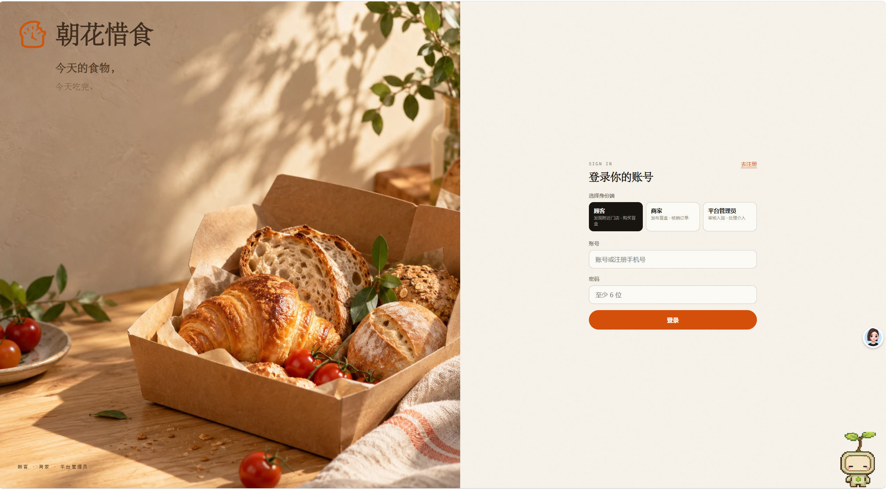
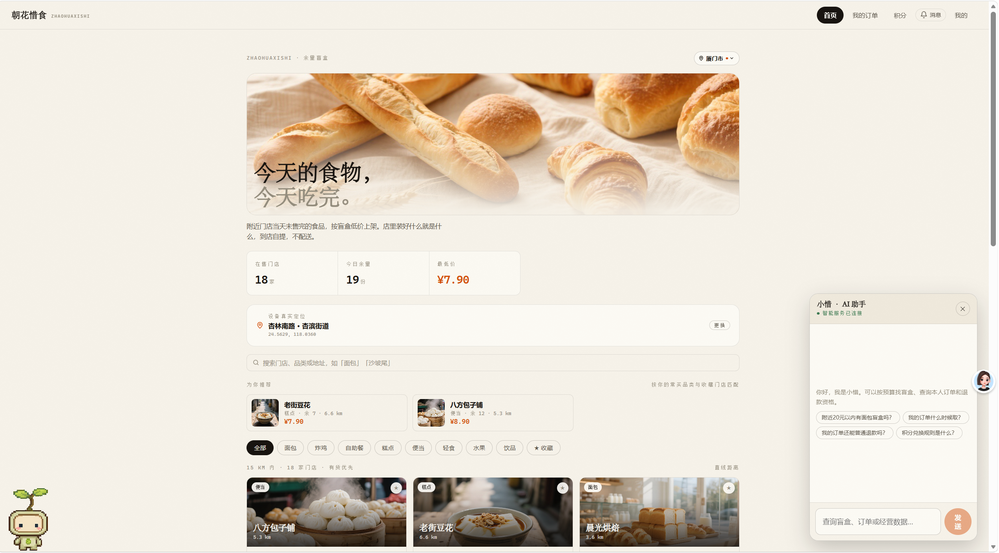
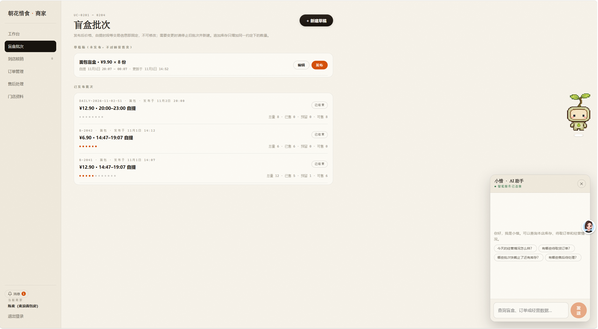
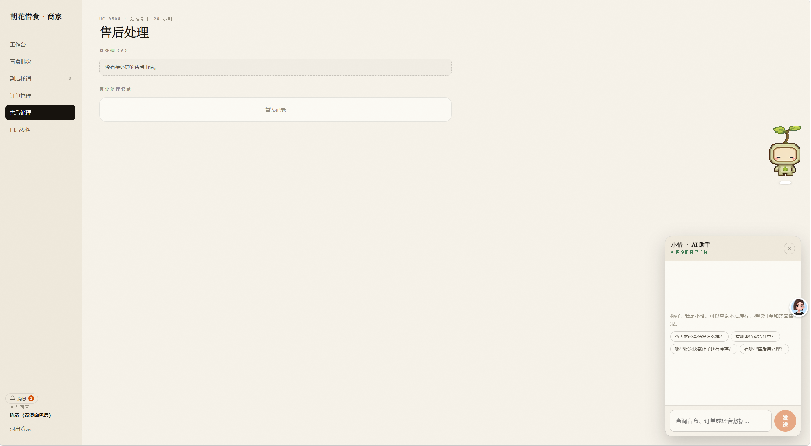
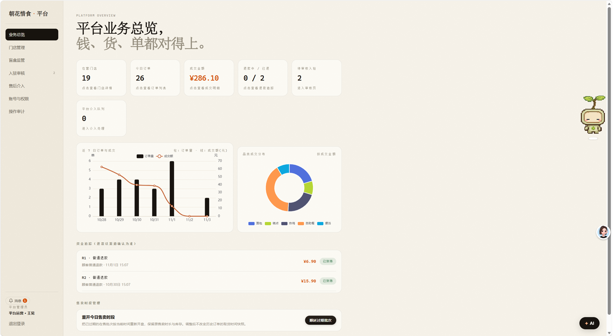

# 朝花惜食 · 余量食品交易平台

商家把当天未售完的食品按批次发布为低价盲盒，顾客在线选购并到店自提。平台管理员负责入驻审核、经营管理和售后争议处理。

这是一个课程项目。演示账号与交易数据用于本地体验，支付和退款使用模拟渠道。

## 项目界面展示

### 1. 启动页 · 身份选择

平台包含顾客端、商家端和管理员端，支持不同角色进入对应的业务系统。



### 2. 顾客端

支持附近门店浏览、盲盒选购、订单查询、收藏评价及积分兑换等功能。



### 3. 商家端

支持盲盒批次发布、库存管理、订单核销、售后处理及经营数据查询。

**盲盒发布页面**



**售后处理页面**



### 4. 管理员端

支持商家入驻审核、门店经营管理、平台业务总览及售后争议处理。



## 两个核心设计

- **限量库存与订单履约**：下单预留库存，确认支付后转为已售，超时未支付自动释放。后端通过事务、行锁和条件更新协调订单与库存，一次性取货码用于到店核销。
- **有权限边界的 AI 查询**：Spring AI 接入 DeepSeek，独立 Spring MVC MCP Server 提供只读查询。顾客查本人订单和附近在售盲盒，商家查本店库存及经营数据，管理员查平台待办。业务后端使用短期票据和归属校验限制查询范围。

## 本地运行

Windows 需要 Node.js、JDK 17 和 Maven。在项目根目录安装依赖：

```powershell
npm ci
```

分别打开两个 PowerShell 窗口，在项目根目录运行 `npm run server` 和 `npm run dev`，打开终端显示的前端地址（默认 http://localhost:5173）。后端首次启动初始化 H2 数据库。

| 身份 | 本地演示账号 | 密码 |
| --- | --- | --- |
| 顾客 | chenxiaoman | 123456 |
| 商家 | mailang | 123456 |
| 管理员 | admin | 123456 |

AI 助手需要另外启动两个服务，配置方式见 [AI 接入说明](ai-services/README.md)。普通交易流程可独立体验。

后端按 Controller、Service、Repository 分层。查看 [业务规则与接口](docs/technical-notes.md) 和 [录屏脚本](docs/demo-script.md)。

运行后端测试：`mvn -f server-java/pom.xml test`。
